  

 

 

<b>&nbsp;✦&nbsp; The human version</b> — click to expand

 

I'm **Devesh** — a developer who turns ideas into polished, premium-feeling products. I work across **desktop software**, **games** and the **web**, and I care as much about how something *feels* as how it works: the motion, the spacing, the last 1% nobody asks for.

- 🔭 **Currently** shipping a Windows wallpaper manager and building a Godot game
- 🌱 **Learning** Python — automation, scripting and backend fundamentals
- 🤝 **Open to** collaborations on creative apps, games and tooling
- 🎧 **Fun fact:** I like music more than coding — it shapes how I think about rhythm and flow

 

 

  
  

  
  

<b>&nbsp;✦&nbsp; Project index</b> — stack &amp; status at a glance

 

| | Project | Type | Stack | Status |
|:-:|---|---|---|---|
| 🖼️ | **Pixel Atlas Desktop** | Desktop app | Electron · React · TypeScript · Dexie | 🟢 Active |
| 🌲 | **WildShire** | Game | Godot · GDScript | 🟢 Active |
| 🏠 | **Fauji Property** | Web app | JavaScript · HTML · CSS | 🟡 In progress |
| 🌐 | **Website** | Website | HTML · CSS | 🔵 Maintained |

Most of these are private while in development — happy to walk you through any of them.

 

 

<b>&nbsp;✦&nbsp; Full toolkit</b> — by category

 

<table>
<tr>
<td align="center" width="33%"><b>LANGUAGES</b>  </td>
<td align="center" width="33%"><b>FRAMEWORKS &amp; ENGINES</b>  </td>
<td align="center" width="33%"><b>TOOLS</b>  </td>
</tr>
</table>

 

 

  
  

  

<b>&nbsp;✦&nbsp; Contribution graph</b> — the last 30 days

 

 

 

